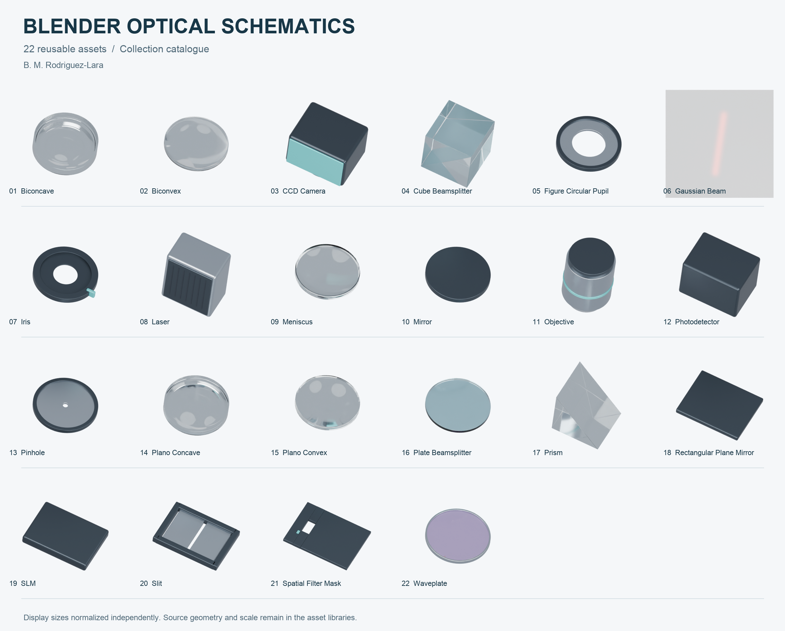
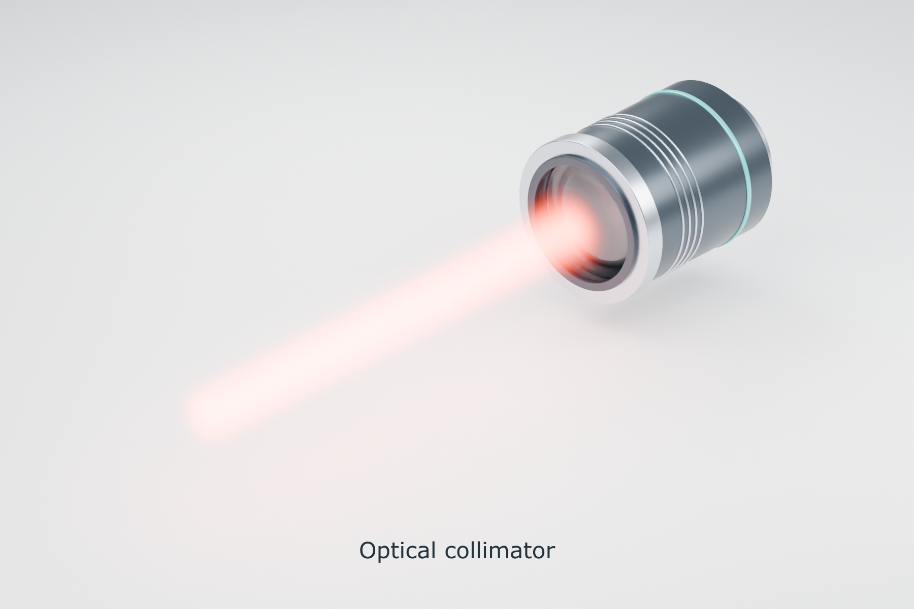
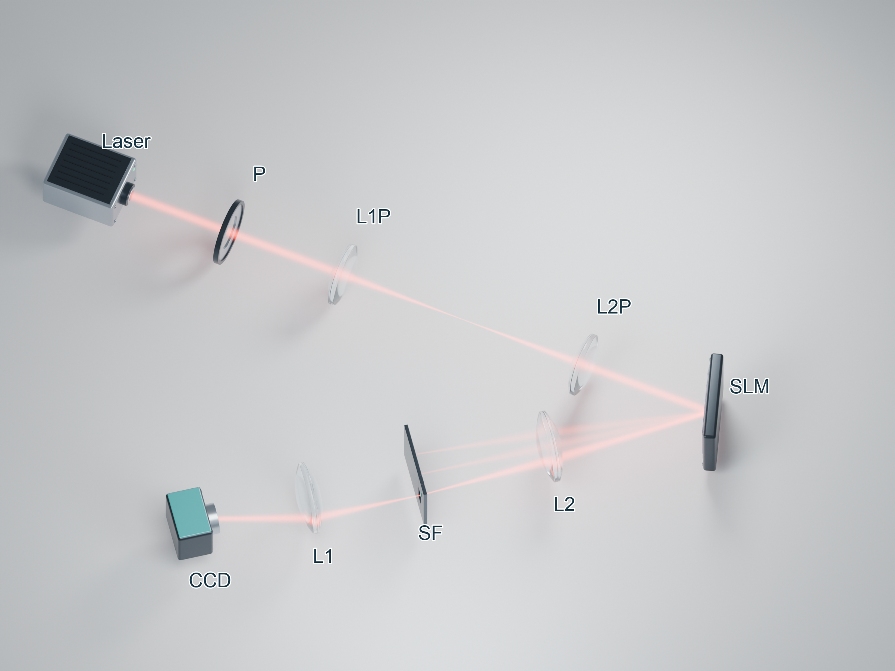

# Blender Optical Schematics

Reusable Blender collections for optical illustrations, including 23 generic optical and beam assets.

**Authors:** B. M. Rodriguez-Lara. [Citation metadata](CITATION.cff).

## Use the library

1. Open Blender. These assets were prepared with Blender 5.2.3 LTS.
2. In Preferences → File Paths → Asset Libraries, add this repository's `library/` folder.
3. Open the Asset Browser and drag a collection into your scene as an instance. Alternatively use File → Append → a library file → Collection.
4. Use source asset scale, not the normalized display sizes shown on this cover. **1 Blender unit = 10 mm (illustrative scale).**

Read the [user guide](docs/user-guide.pdf), its [LaTeX source](docs/user-guide.tex), and the [asset index](docs/assets.json). The [catalogue SVG](images/catalogue-lettered.svg) has editable lettering; its optical rendering is embedded raster.

## Optical collimator

The [generic collimator](examples/collimator/README.md) adds a mounted positive lens with the same glass, graphite and satin-metal materials as the library. [Design and reuse notes](docs/LIBRARY_ADDITIONS_v04.md) include axis conventions and optical assumptions. The original catalogue cover shows the first 22 assets; the collimator preview is shown below.

## Scope

These are visualization assets. Materials and generic optical shapes are illustrative. Beam envelopes are not diffraction simulations. Focal lengths belong in your scene metadata. Do not interpret the catalogue as a dimensioned optical design.

## License and citation

Original code uses MIT; original authored models and documentation use CC BY 4.0. See [LICENSE](LICENSE). This package includes two supplied SLM/CCD reference images for the example, with their existing rights documented separately; it does not include the manuscript PDF. See [material provenance](docs/provenance.md).

## How to cite

Rodriguez-Lara, B. M. (2026). Blender Optical Schematics (Version v0.1.2) [Computer software]. Zenodo. https://doi.org/10.5281/zenodo.23994376

Cite the version you used. The [v0.1.2 DOI](https://doi.org/10.5281/zenodo.23994376) identifies a fixed release; the [all-versions DOI](https://doi.org/10.5281/zenodo.23993947) identifies the project across releases.

Download [BibTeX](docs/citations/schematics.bib), [RIS](docs/citations/schematics.ris), [CSL-JSON](docs/citations/schematics.csl.json), or [plain text](docs/citations/schematics.txt). See the user guide's “How to cite” section. The library citation is separate from the scientific paper.

## Build the documentation

From `docs/`, run `pdflatex user-guide.tex` twice. The PDF uses the included example preview; no private workspace files are needed.

## Generate the paper setup with the agent

Use the included [setup-to-Blender agent](agent/setup-to-blender/SKILL.md) and paste the [clean example request](examples/paper-setup/prompt.md). [Example instructions and inputs](examples/paper-setup/README.md) explain how to generate a later reconstruction of the paper setup. The agent writes and runs the scene builder; it does not require private project files. The SLM hologram and CCD intensity images are included with the example; additional sketches are optional user-provided inputs.

## First-time setup

Start with the [step-by-step guide](docs/user-guide.pdf). Keep the [agent folder](agent/README.md) beside library/. You can call the agent directly by asking Codex to read agent/setup-to-blender/SKILL.md and execute examples/paper-setup/prompt.md. No hidden-folder installation is needed for this direct call. The optional agent/install.py installs a named skill for this project only.

## Reusable POV and propagation accessories

The **Folded Relay — Front-Left** camera preset and three propagation accessories are included. See [camera and accessory instructions](docs/propagation-and-camera.md) and the updated [user guide](docs/user-guide.pdf). The asset manifest now lists 26 collections.

## Optional camera-view search

Ask the agent to compare camera angles when a schematic contains too much empty space. The [camera-view search workflow](docs/camera-view-search.md) supplies preview rendering, a ranked comparison and readability checks. It preserves the original figure and includes the **Folded Relay — Compact Oblique** preset. See the [user guide](docs/user-guide.pdf) for a copyable request.

The [step-by-step user guide](docs/user-guide.pdf) uses the original [paper setup](examples/paper-setup/README.md) throughout, including the saved fixed POV, 15-view sampler and paired SVG export.

After selecting the POV, follow [the finishing steps](docs/scene-finishing.md) to restore the translucent beams and position studio illumination relative to the camera.

## Versioned figures and final approval

Follow [docs/figure-workflow.md](docs/figure-workflow.md) and steps 11a–12a of the user guide. One date-FigXX folder per figure; use python/, blender/, json/, md/, txt/ and existing image folders, with _vXX filename suffixes. Select the POV, save a new illumination version while preserving approved beams and layout, inspect and obtain visual approval, then copy the approved scene and paired SVGs into FinalFigure/. Camera selection alone is not final approval. Close task-opened application windows after saving.
