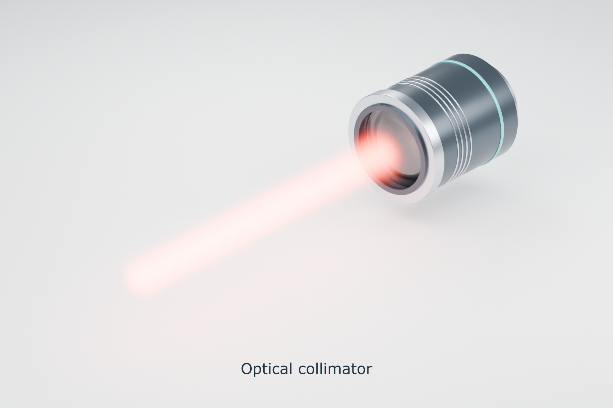

# Generic optical collimator

Append `SO_Collimator` from [the v0.4 asset file](../../library/Bllas_Schematic_Optics_Additions_v04.blend), or use the Asset Browser. The preview beam is separate from the asset. Output points along local -Y; the origin is the output-aperture center. Focal length belongs to scene metadata.

- [Lettered SVG, 86 mm](collimator_lettered_86mm.svg)
- [Unlettered SVG, 86 mm](collimator_unlettered_86mm.svg)
- [Design, materials and optical assumptions](../../docs/LIBRARY_ADDITIONS_v04.md)

Both SVGs embed the raster rendering. Lettering is editable vector text.

To rebuild, run Blender in background mode with `--python scripts/build_collimator.py` from this repository. The builder uses the included `collimator_primitives.py` and `gaussian_beam.py`; no private workspace files are needed. It regenerates the v0.4 library and writes the dated preview to `Figures/2026-11-06-FIg01/`. Preserve manual edits before rebuilding.
